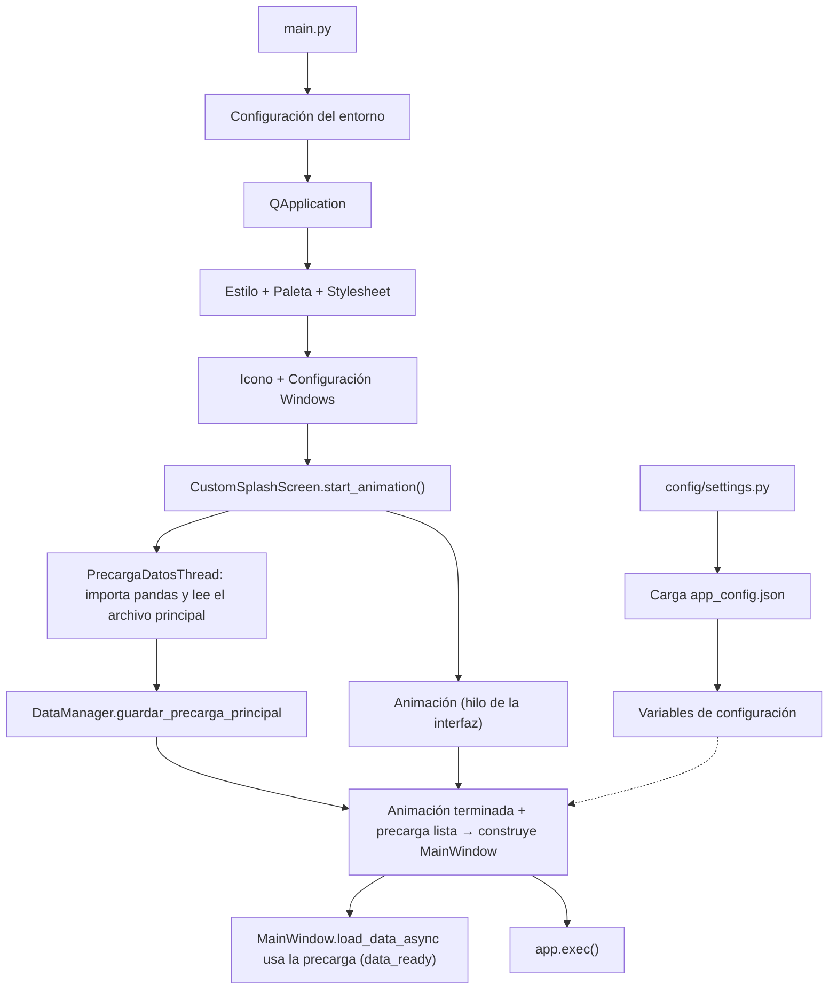

## 1. Propósito

Este documento describe la fase inicial de ejecución de la aplicación **Gestor SSCC** (antes Volvo Dashboard) y su sistema de configuración global.

Registra el comportamiento confirmado en el código fuente actualmente auditado, principalmente `main.py` y `config/settings.py`. Su objetivo es documentar cómo se inicia la aplicación, cómo se prepara el entorno gráfico y cómo se obtiene la configuración necesaria para el funcionamiento del sistema.

La información de este documento representa el **estado actual verificado del código**, por lo que no debe interpretarse como una definición de la arquitectura futura.

---

## 2. Punto de entrada

El archivo `main.py` constituye el punto de entrada directo de la aplicación.

Su responsabilidad durante el arranque incluye:

- Preparar determinadas configuraciones del entorno gráfico (incluida la escala de la interfaz, ver §3.1).
    
- Inicializar `QApplication`.
    
- Configurar el estilo y la paleta visual de Qt.
    
- Cargar la hoja de estilos global.
    
- Configurar el icono de la aplicación.
    
- Mostrar el Splash Screen.
    
- Controlar la transición hacia `MainWindow`.
    
- Iniciar el ciclo principal de eventos de Qt.
    

---

## 3. Flujo de inicialización

El proceso de arranque muestra una animación de inicio mientras un hilo de fondo lee los datos principales; `MainWindow` se construye recién cuando ambas cosas terminaron (actualizado 01-10-2026, ver 3.6–3.8).

### 3.1 Configuración del entorno gráfico

Al comenzar la ejecución, `main.py` establece la variable de entorno:

`QT_QPA_PLATFORM=windows:darkmode=0`

Esto se utiliza para desactivar el modo oscuro de Windows para la aplicación.

**Escala de la interfaz (nuevo 29-09-2026).** Justo después, y antes de crear `QApplication`, `main.py` llama a `aplicar_escala_al_entorno()` (`src/theme/ui_scale.py`), que fija la variable de entorno `QT_SCALE_FACTOR` según el nivel elegido por el usuario en Configuración (ver [[03_Vistas_y_Navegacion_UI]] §3 y [[10. Manual de Operación]] §11):

| Nivel | Clave guardada | `QT_SCALE_FACTOR` |
| :--- | :--- | :--- |
| Pequeño | `pequeno` | 0.85 |
| Mediano (por defecto, tamaño con el que se diseñó la UI) | `mediano` | 1.0 |
| Grande | `grande` | 1.25 |

- El nivel se guarda en `QSettings("VolvoApp", "Dashboard")`, clave `ui_scale` (registro de Windows, por usuario y por equipo), **no** en `app_config.json`. Un valor desconocido o ausente se trata como `mediano`.
- Qt multiplica por este factor todos los tamaños lógicos: fuentes, px de las hojas de estilo, anchos/altos fijos, íconos, diálogos y el propio Splash. Se suma al escalado de Windows (DPI), que Qt 6 ya aplicaba antes. Ejemplo: en una pantalla 1920×1080 con Windows al 150 %, el área lógica es 1280×720 en Mediano, 1506×847 en Pequeño y 1024×576 en Grande.
- Qt solo lee `QT_SCALE_FACTOR` al crear `QApplication`, así que un cambio de nivel **requiere reiniciar la aplicación**. La variable se fija siempre, incluso con 1.0, porque el proceso relanzado con `QProcess.startDetached` hereda el entorno del proceso anterior.
- **Motivo:** la UI tiene cientos de tamaños fijos en px (fuentes, márgenes, anchos). En pantallas con más área lógica (por ejemplo, 1920×1080 al 100 %) todo se veía pequeño y con espacio sobrante. El factor global corrige eso sin reescribir esos valores.

### 3.2 Inicialización de QApplication

Se crea la instancia principal de PyQt6 mediante:

`QApplication(sys.argv)`

Este objeto constituye la base del entorno gráfico sobre el cual se ejecuta la aplicación.

**Instancia única (08-10-2026):** justo después, `_asegurar_instancia_unica()` (`main.py`) intenta conectarse a un `QLocalServer` de nombre fijo (`volvo.dashboard.gestion.instancia`). Si responde, ya hay otra aplicación abierta: le envía el mensaje "mostrar" (esa instancia trae su ventana al frente con `_traer_al_frente()`) y la nueva termina sin cargar nada. Si nadie responde, descarta cualquier servidor huérfano de un cierre abrupto y crea el suyo. Vale por sesión de Windows. Solo se probó con un script que simula dos procesos, no con el ejecutable.

### 3.3 Configuración visual

La aplicación fuerza el estilo de Qt denominado `Fusion`. **Actualizado (01-10-2026):** la paleta ya no se fija en `main.py`; la aplica `GestorTema` (`src/theme/tema.py`) según el último tema que usó la persona (clave `tema_oscuro` en `QSettings("VolvoApp", "Dashboard")`). En modo claro es la misma paleta clara de antes. `windows:darkmode=0` se mantiene: el modo oscuro es de la app, no se toma del de Windows. Detalle en [[03_Vistas_y_Navegacion_UI]] §5.

### 3.4 Carga de estilos

`main.py` utiliza `load_stylesheet` para leer y aplicar el archivo:

`src/assets/styles.qss`

Este archivo contiene estilos globales utilizados por la interfaz. Justo después, `main.py` llama a `GestorTema.instancia().inicializar(app)`: si el tema guardado es oscuro, la hoja global se aplica ya convertida a colores oscuros.

### 3.5 Configuración del icono

Se carga el recurso:

`src/assets/splash_logo.png`

y se procesa mediante `create_white_background_icon` para generar el icono utilizado por la aplicación.

Además, se utiliza configuración específica de Windows mediante `ctypes` para establecer un identificador de aplicación que permite agrupar correctamente el proceso en la barra de tareas.

### 3.6 Splash Screen (rediseñado 01-10-2026)

`CustomSplashScreen` (`main.py`) hereda la animación de `PantallaInicio` (`src/ui/pantalla_inicio.py`) y solo agrega la lógica de carga y cierre. La animación (760×430, sin bordes) se dibuja entera con `QPainter` y colores fijos: no usa hojas de estilo ni la paleta de la app, así que **el modo oscuro no la afecta**. Secuencia: el isotipo gira 360° sobre su eje vertical (0–1,1 s), "VOLVO" plateado crece desde el fondo junto con el contorno de la barra (0,85–1,9 s), y la barra se llena mientras aparece la silueta del camión (`sidebar_truck.png` oscurecido) con los focos encendidos (1,9–3,3 s). El isotipo se dibuja por código; `splash_logo.png` sigue usándose solo para el ícono (3.5). Detalle visual en [[03_Vistas_y_Navegacion_UI]] §2.

### 3.7 Lectura de datos en paralelo a la animación

`start_animation()` desactiva el recolector de basura de Python (`gc.disable()`) y lanza `PrecargaDatosThread`:

1. El hilo importa pandas y fuerza sus módulos de lectura y fechas (`_calentar_pandas`) y emite `importado`. La animación arranca con esa señal (o a los 1,5 s como máximo, `ESPERA_MAXIMA_IMPORTS_MS`); antes solo se ve el fondo.
2. Luego lee y limpia el archivo principal con `leer_datos_principales` (la misma función de `MainDataLoaderThread`, ver [[02_Motor_de_Datos_Core]]).
3. Al terminar, el splash guarda la lectura con `DataManager.guardar_precarga_principal(...)`.

Mientras dura la lectura, `main()` baja el intervalo de cambio de hilo de Python a 1 ms (`INTERVALO_GIL_ARRANQUE`; se restaura a 5 ms al terminar). Motivo y mediciones en [[12. Rendimiento y Optimizaciones de Interfaz]] §12.

La barra avanza sola (por tiempo) hasta un **tope de 70 %** (`TOPE_VISUAL`, actualizado 22-10-2026; antes 95 %); el resto lo marca la carga real con `set_progreso()`. Si la barra se completa y la lectura sigue, queda con "Esperando datos...".

### 3.8 Creación de MainWindow e inicio del Event Loop

Cuando la animación llegó al final (3,4 s, `INTRO_MINIMA`) **y** la precarga terminó, la barra sube a 100 %, se pinta "Abriendo la aplicación..." y `_abrir_aplicacion()` reactiva el recolector de basura, construye `MainWindow` y la muestra; el splash se desvanece encima (320 ms) y se cierra. `MainWindow.__init__` llama a `load_data_async()` como siempre, pero encuentra la precarga y la usa sin volver a leer el archivo.

Si la precarga falla, el error solo se imprime en consola: `MainWindow` hace su propia lectura y muestra su pantalla de error. Si falla la construcción de `MainWindow`, `_manejar_error_fatal` registra el error en `logs/sistema.log` y lo muestra, igual que antes.

El ciclo principal de eventos (`app.exec()`) se inicia después de construir el splash y llamar a `start_animation()`.

**Actualizado (22-10-2026):** `_abrir_aplicacion()` construye `MainWindow(arranque_oculto=True)`: la ventana se muestra con opacidad cero, carga todas sus pantallas mientras el splash sigue animándose (`progreso_arranque` mueve la barra) y, al emitir `arranque_listo`, el splash llama a `MainWindow.revelar()` y se desvanece. Así la pantalla de carga interna no llega a verse. Espera máxima: 120 s (`ESPERA_MAXIMA_ARRANQUE_MS`). Detalle en [[12. Rendimiento y Optimizaciones de Interfaz]] §12b.

**Actualizado (23-10-2026):** `_abrir_aplicacion()` reparte el trabajo en etapas separadas por `PAUSA_ENTRE_ETAPAS_MS` (40 ms): importar pantallas (`_importar_pantallas`), crear la ventana (`_crear_ventana_principal`) y cargar el resto, para que el splash siga animándose. La precarga de pantallas de `MainWindow` espera a que el equipo esté inactivo (`GetLastInputInfo`, `PRECARGA_ESPERA_INACTIVIDAD_MS`) y se aplaza hasta `PRECARGA_MAX_APLAZAMIENTOS` veces. Detalle y lo descartado en [[12. Rendimiento y Optimizaciones de Interfaz]] §15.2.

**Historial:** hasta el 01-10-2026, `start_animation()` construía `MainWindow` de inmediato y el splash cerraba con `data_ready`/`load_error`; esa construcción en el hilo de la interfaz congelaba la animación.
    

---

## 4. Configuración

El módulo `config/settings.py` centraliza la obtención de rutas, configuraciones y determinados valores utilizados por otros componentes de la aplicación.

### 4.1 Resolución de la ruta base

El módulo determina la ubicación base de ejecución comprobando si la aplicación se encuentra ejecutándose como un ejecutable generado mediante PyInstaller (`sys.frozen`).

- En ejecución como aplicación empaquetada, utiliza la ubicación del ejecutable.
    
- En ejecución como código Python, utiliza la ubicación correspondiente al proyecto/script.
    

### 4.2 Carga de configuración

El módulo ejecuta `load_config()` para localizar y cargar:

`app_config.json`

Si el archivo no existe, se genera utilizando el diccionario `DEFAULT_CONFIG`.

Cuando el archivo existe, sus claves se comparan con `DEFAULT_CONFIG` y se incorporan aquellas que estén ausentes.

Este mecanismo permite mantener cierta compatibilidad con configuraciones creadas con versiones anteriores de la aplicación.

### 4.3 Variables de configuración

Los valores obtenidos desde `app_config.json` se exponen mediante variables del módulo para que otros componentes puedan importarlos.

Entre ellas se encuentran valores relacionados con:

- rutas de archivos Excel;
    
- rutas de archivos de provisiones;
    
- ubicaciones de datos;
    
- URLs externas;
    
- otros parámetros de configuración.
    

### 4.3.1 Derivación automática de rutas (no persistida en disco)

Además de comparar contra `DEFAULT_CONFIG`, `settings.py` deriva en memoria dos claves si faltan en `app_config.json`: `LOG_CSV_PATH` (a partir de `LOG_EXCEL_PATH`) y `CASOS_BAJA_CM_PATH` (a partir del directorio de `EXCEL_PATH`). Esta derivación no reescribe el `app_config.json` real en disco, solo completa las variables expuestas por el módulo en memoria.

### 4.3.2 Carpeta de datos (`DATA_DIR`) y asistente de rutas (06-10-2026)

Para que la persona no tenga que escribir una ruta por archivo, la configuración admite una clave `DATA_DIR` (la carpeta donde viven los archivos de datos). `config/rutas.py` guarda el catálogo de **nombres** estándar (`ARCHIVOS_DE_DATOS`: `RM_JAVI.csv`, `LogApp.csv`, `RegistroEliminado.xlsx`, `provisionFelipe.xlsx`, `Instalaciones.xlsx`, `contactos.xlsx`, `Correos.csv`, `CasosBajaCM.csv`, `BBDD CLIENTES CM.xlsx`, `facturacionManual.xlsx` y `RM_JAVI_VOLVO CONNECT.xlsx`); ninguna ruta completa está escrita en el código.

- **Derivación:** `load_config()` llama a `completar_rutas`, que rellena en memoria las rutas vacías con `DATA_DIR` + nombre estándar. Una ruta ya definida en `app_config.json` siempre gana, así que las configuraciones anteriores siguen funcionando. `RM_JAVI_PATH` no se deriva (suele vivir en otra carpeta).
- **Directorio de ejecutivos y modo programador (15-10-2026):** `EJECUTIVOS_PATH` (`Ejecutivos_VC.csv`, opcional) es otra clave de `rutas.ARCHIVOS_DE_DATOS`; `ejecutivos_service.get_ejecutivos_csv_path` la usa si su carpeta existe y, si no, mantiene el comportamiento anterior (carpeta de `EXCEL_PATH`). `settings.MODO_PROGRAMADOR` (constante en `settings.py`, o la variable de entorno `GESTOR_SSCC_PROGRAMADOR=1`) muestra en Configuración la pestaña Avanzado; las claves de `rutas.CLAVES_SOLO_PROGRAMADOR` (hoy `RM_JAVI_PATH`) no se listan en Archivos.
- **Autodetección:** `descubrir_archivos(carpeta, subir=2)` busca cada nombre en la carpeta y sus subcarpetas y, si no aparece, en hasta dos niveles hacia arriba (así encuentra el RM de Javiera en una carpeta hermana). `buscar_carpeta_de_datos(inicio)` recorre desde la carpeta del usuario (hasta 4 niveles, con un máximo de 10 s) buscando la que contiene `RM_JAVI.csv`; ignora carpetas de respaldo y ocultas. **Nombre del archivo (13-10-2026):** el Registro Maestro se llamaba `PruebasFM.csv` y pasó a `RM_JAVI.csv` (mismo contenido; la clave `EXCEL_PATH` no cambia). Una carpeta que aún tenga `PruebasFM.csv` no se autodetecta: hay que renombrar el archivo o apuntar `EXCEL_PATH` a mano.
- **Pantalla Configuración:** pestaña "Archivos" con Examinar carpeta, Autodetectar archivos, Abrir carpeta, "¿Cómo me conecto?" (`GuiaConexionDialog`) y una lista de estado (✓/✗, fecha y tamaño por archivo). Las rutas individuales dejaron de editarse a mano: `ConfiguracionModule.path_inputs` sigue existiendo, pero como campos ocultos que completa la carpeta de datos. Ver [[03_Vistas_y_Navegacion_UI]] §3.
- **Primer arranque:** `main.py` llama a `asistente_rutas.revisar_rutas_al_arrancar()` antes del splash. Si `EXCEL_PATH` no existe, abre un asistente que busca la carpeta sola (o permite elegirla), muestra qué archivos encontró y, al confirmar, guarda `DATA_DIR` y las rutas y reinicia la aplicación. Con "Abrir sin configurar" el arranque sigue como antes.
- **Limpieza:** `save_config` descarta las claves obsoletas `CUSTOMER_EXCEL_PATH` y `POWERBI_URL` (ver §5.3).

### 4.4 WATCH_DIR

`WATCH_DIR` se calcula dinámicamente a partir de la ubicación definida mediante `EXCEL_PATH`.

Su finalidad está relacionada con la determinación del directorio que debe ser monitoreado por los componentes correspondientes.

El funcionamiento completo del monitoreo deberá verificarse posteriormente mediante la auditoría de `file_watcher.py` y los componentes que utilicen esta variable.

---

## 5. Archivos de configuración

El sistema utiliza principalmente dos archivos JSON relacionados con la configuración.

### 5.1 app_config.example.json

Funciona como plantilla estructural de la configuración.

Su finalidad es mostrar las claves esperadas sin contener necesariamente los valores específicos de la instalación local.

### 5.2 app_config.json

Es el archivo de configuración utilizado por la instalación local.

Contiene valores específicos de la máquina, incluyendo rutas de archivos y URLs utilizadas por la aplicación.

Debido a que puede contener información específica del entorno corporativo, debe tratarse como configuración local y no debe asumirse automáticamente como un archivo apto para distribución pública.

### 5.3 Inconsistencia detectada

Durante la auditoría se identificó una diferencia en la nomenclatura de la URL de Power BI.

`DEFAULT_CONFIG` y `app_config.example.json` utilizan:

`POWERBI_URL`

Mientras que el archivo `app_config.json` y la lectura realizada en `settings.py` utilizan:

`POWERBI_EMBED_URL`

Esta diferencia constituye una **inconsistencia actual de configuración** y deberá ser revisada posteriormente.

No se realiza ninguna corrección en esta etapa.

> **Actualización (06-10-2026):** `save_config` ya no escribe `POWERBI_URL` ni `CUSTOMER_EXCEL_PATH` (`config/rutas.py`, `CLAVES_OBSOLETAS`): nada las lee. `POWERBI_URL` sigue en `DEFAULT_CONFIG`, pero se descarta al guardar; la URL del dashboard sigue siendo `POWERBI_EMBED_URL`.
>
> **Actualización (16-10-2026):** `POWERBI_EMBED_URL` ya no la lee ninguna pantalla (el Dashboard dejó de usar Power BI, ver [[03_Vistas_y_Navegacion_UI]]) y se quitó de la pantalla Configuración. `settings.py` y los JSON todavía la conservan, por lo que la inconsistencia de arriba ya no tiene efecto práctico.

---

## 6. Dependencias relevantes

Las dependencias directamente relacionadas con esta fase son principalmente:

### PyQt6

Es la biblioteca utilizada para:

- crear `QApplication`;
    
- administrar el entorno gráfico;
    
- crear ventanas;
    
- ejecutar el Splash Screen;
    
- gestionar el `QTimer`;
    
- iniciar el Event Loop.
    

### Componentes nativos de Windows

`main.py` utiliza `ctypes` para realizar determinadas configuraciones específicas del sistema operativo Windows, relacionadas principalmente con la identificación de la aplicación en la barra de tareas.

Otras dependencias definidas en `requirements.txt` serán documentadas cuando se auditen los componentes que las utilizan.

---

## 7. Flujo resumido

> **Nota:** La relación entre `settings.py` y `MainWindow` es representativa de una dependencia de configuración y no implica que `settings.py` sea ejecutado como una etapa secuencial independiente del arranque. El mecanismo exacto de consumo de configuración será confirmado durante la auditoría de los módulos posteriores.

---

## 8. Observaciones del estado actual

### 8.1 Código duplicado inalcanzable (CORREGIDO — 03-09-2026)

Se había identificado un bloque de código duplicado en `main.py` relacionado con la creación del icono, el Splash Screen y la finalización de la aplicación.

Ese bloque se encontraba después de una llamada previa a `sys.exit(app.exec())`, por lo que nunca podía alcanzarse durante la ejecución normal. Fue eliminado por ser código muerto sin efecto alguno; `main()` termina ahora directamente en el primer `sys.exit(app.exec())`.

**Bug adicional corregido en el mismo bloque:** en el manejo de la excepción fatal de arranque (dentro de `CustomSplashScreen.update_progress`), se llamaba a `datetime.now()` aunque el módulo se importa con `import datetime` (no `from datetime import datetime`), lo que lanzaba `AttributeError`. Como esa llamada estaba envuelta en un `except Exception: pass` más externo, el error se silenciaba y el detalle del error crítico no llegaba a escribirse en el log de arranque. Se corrigió a `datetime.datetime.now()`.

### 8.2 Simulación visual de carga (actualizado 01-10-2026)

Los mensajes de estado del splash ("Cargando motor de datos...", "Sincronizando orígenes de datos...", "Construyendo interfaz...") dependen del avance visual de la barra, no de eventos reales de procesamiento: son cosméticos. Los únicos reales son "Esperando datos..." (animación terminada, lectura en curso) y "Abriendo la aplicación..." (se está construyendo `MainWindow`).

El cierre depende de la precarga, de la carga de las pantallas y del fin de la animación (ver 3.8), no del avance de la barra; por eso el avance por tiempo tiene un tope de 60 % (`TOPE_VISUAL`; era 70 % hasta el 22-10-2026, actualizado 23-10-2026).

### 8.3 Inconsistencia de configuración

Existe una diferencia entre la clave `POWERBI_URL` definida en `DEFAULT_CONFIG`/`app_config.example.json` y `POWERBI_EMBED_URL`, utilizada por la configuración real y por la lectura realizada desde `settings.py`.

Si `app_config.json` fuera eliminado y se generara nuevamente a partir de `DEFAULT_CONFIG`, esta diferencia podría provocar que la configuración generada no contenga la clave esperada por el código que consume `POWERBI_EMBED_URL`.

Este punto queda registrado como deuda técnica pendiente de revisión.

---

## 9. Dependencias pendientes de auditoría

Para completar la comprensión del arranque y determinar qué procesos se ejecutan durante la creación de la ventana principal, quedan pendientes de revisión:

### `src/ui/main_window.py` → [[03_Vistas_y_Navegacion_UI]]

Debe analizarse su método de inicialización para determinar:

- qué módulos carga;
    
- qué componentes crea;
    
- qué procesos inicia;
    
- qué operaciones pueden ejecutarse durante el arranque;
    
- qué tareas son delegadas a workers;
    
- qué impacto puede tener su inicialización sobre el rendimiento.
    

### `src/core/data_manager.py` → [[02_Motor_de_Datos_Core]]

Debe analizarse para determinar:

- cómo se inicializa;
    
- qué datos administra;
    
- qué componentes dependen de él;
    
- cuándo se cargan los datos;
    
- qué workers o procesos coordina;
    
- cómo se relaciona con el flujo de arranque.
    

El análisis de estos archivos permitirá complementar esta documentación y determinar con mayor precisión la arquitectura real del sistema.

---

## Documentos relacionados

- [[00_Indice_Principal]] — versión en formato de auditoría/hallazgos de este mismo tema (arranque y configuración)
- [[02_Motor_de_Datos_Core]] — DataManager y componentes Core pendientes de auditoría según este documento
- [[03_Vistas_y_Navegacion_UI]] — MainWindow y módulos de interfaz pendientes de auditoría según este documento
- [[08. Arquitectura Visual y Diagramas]] — diagrama visual del flujo de arranque descrito en la sección 3 de este documento
- [[09. Despliegue y Onboarding]] — instalación, requisitos y configuración práctica para un equipo nuevo