Este documento es la **capa visual** de la arquitectura y del funcionamiento de **Gestor SSCC**. Reúne los diagramas Mermaid (compatibles con el grafo de Obsidian) en tres partes: lo que cualquier persona del equipo necesita entender, los procesos de negocio en detalle y la arquitectura técnica. Una cuarta parte reúne los cinco diagramas originales hechos en draw.io (archivos `.drawio` de la carpeta `diagramas`), que se ven dibujados en `diagramas/index.html`. No reemplaza a [[04. Arquitectura y Patrones del Sistema]] ni a [[05. Flujos de Datos y Sincronización]]: son la fuente de verdad técnica. Las pantallas se explican en lenguaje de negocio en [[14. Guía de General, Comercial y Operaciones]] y [[15. Guía de Ingresos y Conciliación]].

Cada diagrama indica el documento donde está la explicación detallada. Si un diagrama y su documento técnico llegan a contradecirse (por un cambio de código no reflejado aquí todavía), **prevalece el documento técnico**.

**Sobre `diagramas/index.html`:** es una copia de estos mismos diagramas pensada para compartirse fuera de Obsidian (se abre directo en un navegador, con conexión a internet para dibujar los diagramas). **No es un archivo autogenerado ni una fuente de verdad**: no hay ningún script en el repositorio que lo mantenga sincronizado, así que cualquier diagrama nuevo o corregido aquí debe replicarse a mano en ese HTML. Ante una diferencia, prevalece este documento. Última revisión completa: 13-10-2026 (contratos por ID, archivo `RM_JAVI.csv`, Operaciones, Ingresos y Conciliación).

**Colores de los diagramas**

| Color | Significa |
|---|---|
| Azul claro | Pantalla de la aplicación |
| Azul oscuro | Grupo del menú |
| Verde | Acción o resultado correcto |
| Gris | Archivo de datos o dato guardado |
| Violeta | Sistema o archivo externo (Power BI, Outlook, Volvo Connect, reportes) |
| Amarillo | Aviso o paso pendiente |
| Rojo claro | Baja, alerta o riesgo |

---

## Parte A — Para todo el equipo

Explicado en palabras simples, sin nombres de clases ni términos técnicos. Si es tu primera vez aquí, empieza por esta parte.

### A1 — Mapa de la aplicación

> Ver explicación detallada: [[03_Vistas_y_Navegacion_UI]] §3, [[10. Manual de Operación]]

Estas son las pantallas del menú lateral y para qué sirve cada una. Configuración no está en el menú: tiene su propio botón en el encabezado.

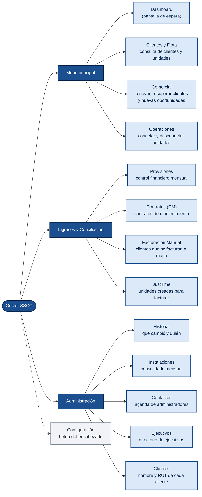

- **Dónde seguir leyendo:** [[14. Guía de General, Comercial y Operaciones]] y [[15. Guía de Ingresos y Conciliación]] explican cada pantalla con más detalle.

---

### A2 — Un contrato por fila

> Ver explicación detallada: [[07. Procesos y Reglas de Negocio]] §1.aa, [[14. Guía de General, Comercial y Operaciones]] §1

Cada fila del Registro Maestro es un contrato, con su propio N° Contrato. Una misma unidad puede tener varios contratos a lo largo del tiempo; las pantallas muestran siempre el último (el de mayor número).

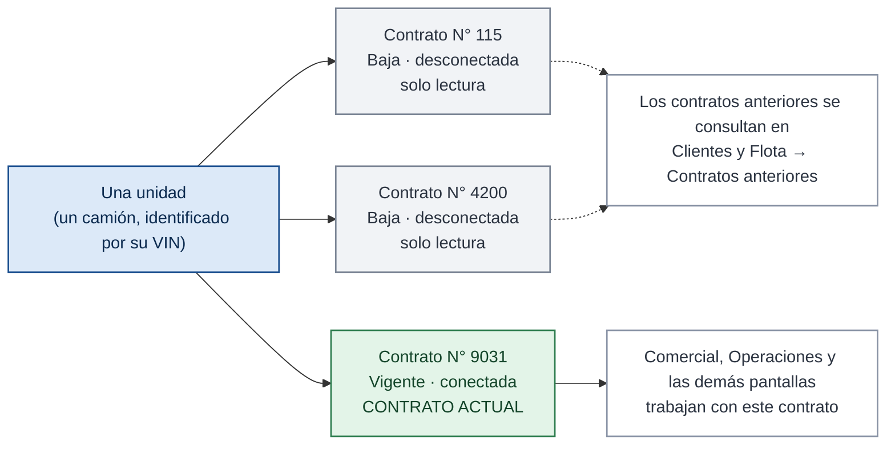

- Los números de contrato del dibujo son un **ejemplo**.
- Un contrato terminado (**Baja** o **Baja Solicitada**) no se edita. Si el cliente vuelve, no se reabre: se crea un contrato nuevo con otro N° Contrato.
- Así Javiera y el equipo conservan el historial de años anteriores cuando una unidad se reactiva.

---

### A3 — Ciclo de vida de un contrato

> Ver explicación detallada: [[07. Procesos y Reglas de Negocio]] §1.aa, [[10. Manual de Operación]] §3

Los pasos por los que pasa un contrato, desde que se crea hasta que termina, y quién hace cada cambio.

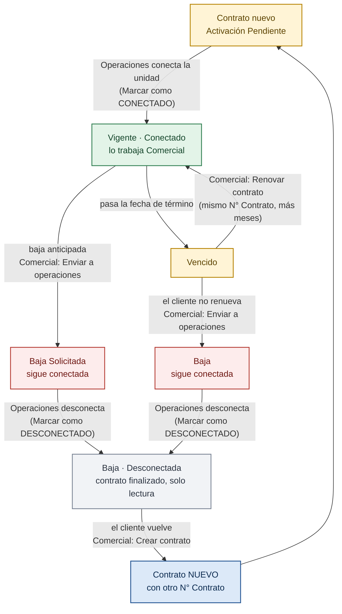

- La baja anticipada pasa primero por **Baja Solicitada**; cuando Operaciones desconecta la unidad, queda en **Baja**.
- **Crear contrato** solo se permite si la unidad ya no está Activando ni Conectada.

---

### A4 — ¿Comercial u Operaciones?

> Ver explicación detallada: [[10. Manual de Operación]] §3, [[07. Procesos y Reglas de Negocio]] §1.y

La aplicación decide sola a qué pantalla va cada contrato cruzando su estado comercial con su estado de activación. Nadie lo edita a mano.

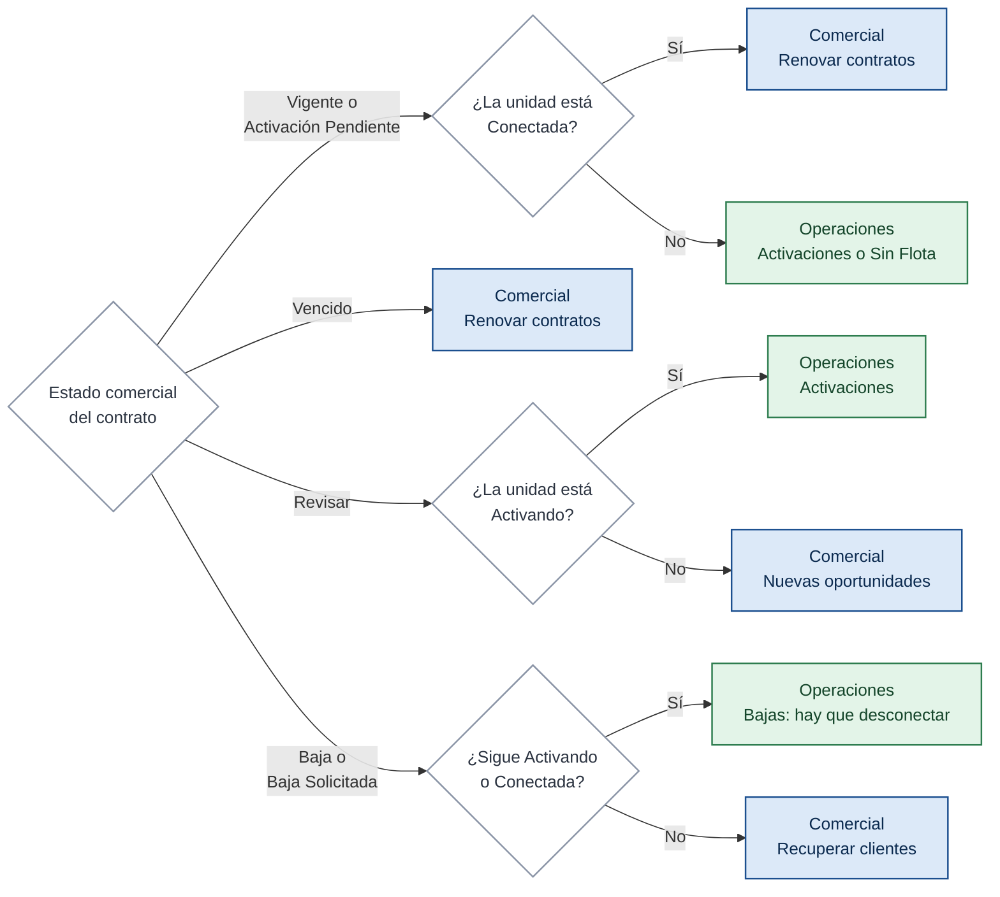

- Un contrato Vigente que no está Conectado suele ser un error de datos del Excel: se muestra donde corresponde, pero conviene corregirlo.
- La tabla completa de combinaciones está en el Manual de Operación.

---

### A5 — Operaciones: primero Volvo Connect, después la aplicación

> Ver explicación detallada: [[14. Guía de General, Comercial y Operaciones]] §4, [[07. Procesos y Reglas de Negocio]] §3

La aplicación no se conecta con Volvo Connect. Operaciones hace el trabajo real en Volvo Connect y después lo registra en la aplicación, siempre en este orden.

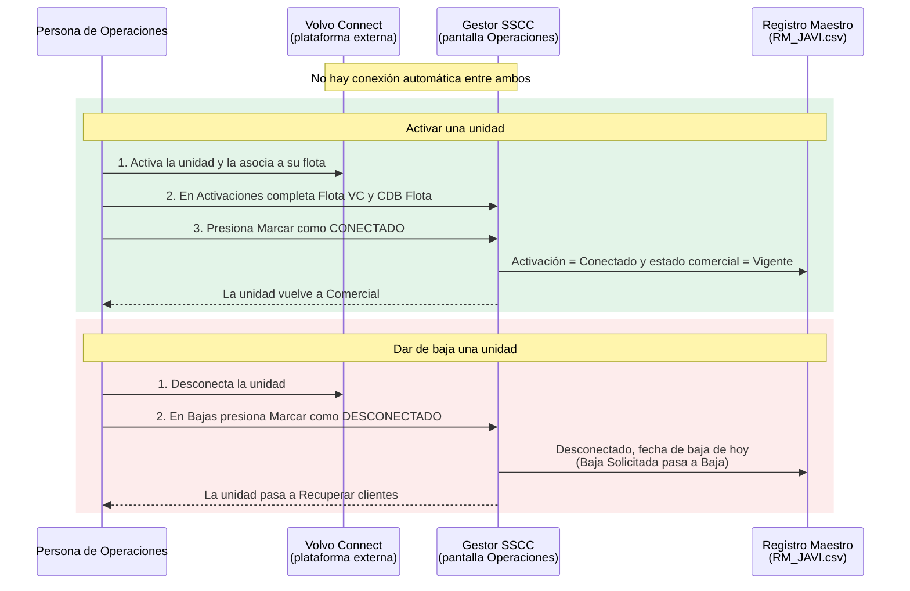

- Si se invierte el orden, el registro queda mal: por ejemplo, una unidad marcada como desconectada en la aplicación que sigue conectada en Volvo Connect.
- Si la unidad aún no aparece en Volvo Connect, se usa **Marcar como SIN FLOTA** y se espera a que aparezca.

---

### A6 — Ejemplo: baja anticipada de un camión

> Ver explicación detallada: [[14. Guía de General, Comercial y Operaciones]] §5

El recorrido completo cuando un cliente pide dar de baja un camión antes de que termine su contrato, y qué pasa si después vuelve.

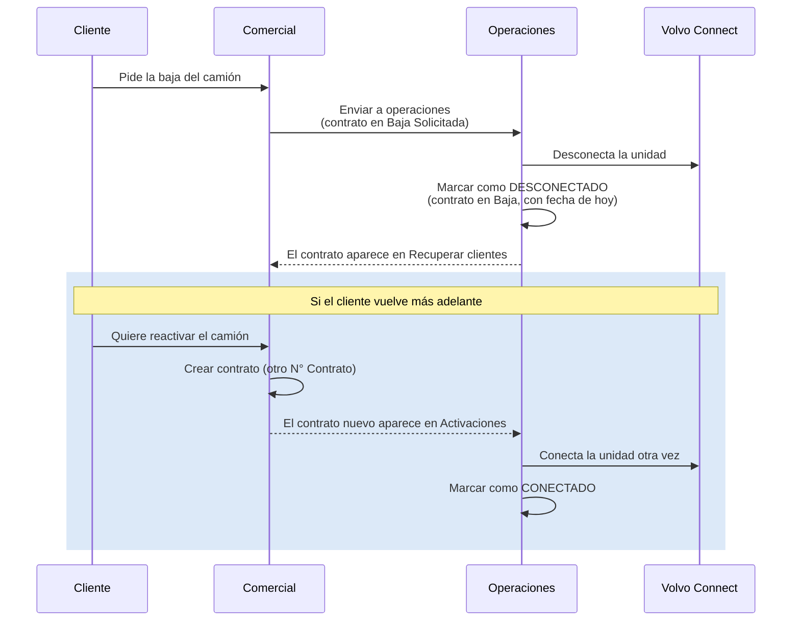

- El contrato anterior no cambia: queda como historia, de solo lectura.

---

### A7 — Ingresos y Conciliación: qué hace cada pantalla

> Ver explicación detallada: [[15. Guía de Ingresos y Conciliación]], [[07. Procesos y Reglas de Negocio]] §2, §4, §9 y §10

De dónde sale la información de cada pantalla de facturación y qué produce.

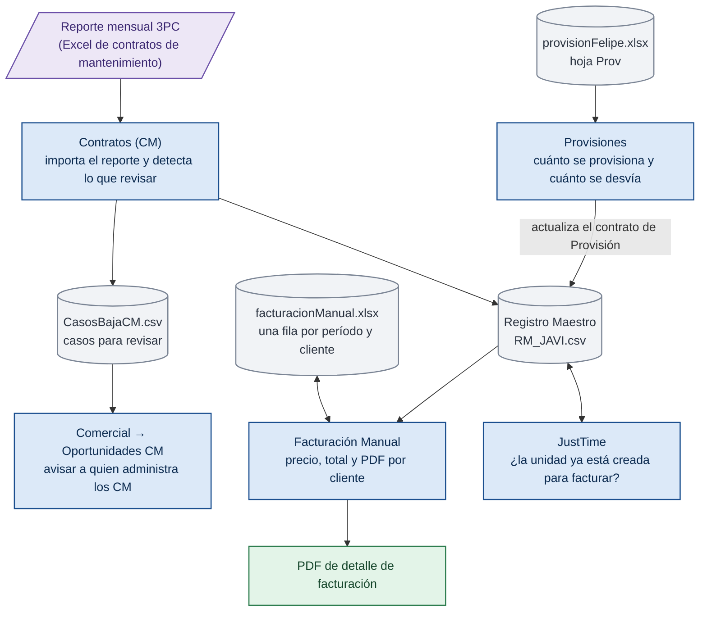

- Las cuatro trabajan sobre el **contrato actual** de cada unidad. Un contrato terminado y desconectado deja de aparecer.
- Los roles de cada pantalla y su detalle están en [[15. Guía de Ingresos y Conciliación]].

---

### A8 — Dónde vive la información

> Ver explicación detallada: [[02_Motor_de_Datos_Core]], [[01_Arranque_y_Configuracion]]

Los archivos de datos de la aplicación y qué pantallas los usan. El Registro Maestro es el archivo central: casi todas las pantallas lo leen y varias lo modifican.

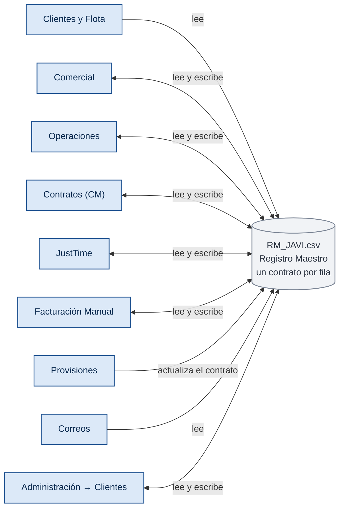

- Cada guardado hace antes una copia de seguridad y queda anotado en el historial de cambios (`LogApp.csv`).

---

### A9 — Los demás archivos de datos

> Ver explicación detallada: [[01_Arranque_y_Configuracion]], [[05. Flujos de Datos y Sincronización]]

Cada archivo tiene su pantalla. Los de color violeta vienen de fuera de la aplicación (Power BI o el bot de Volvo Connect).

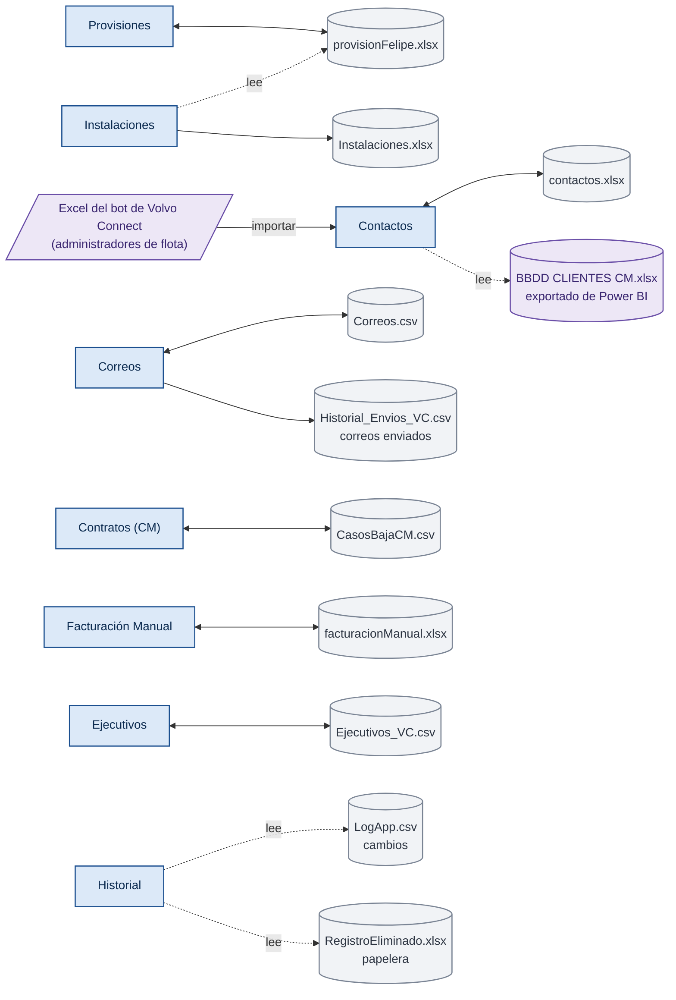

---

### A10 — ¿Qué pasa cuando guardo un cambio?

> Ver explicación detallada: [[06. Seguridad, Integridad y Resiliencia de Datos]], [[10. Manual de Operación]]

El recorrido de cualquier edición, explicado sin términos técnicos.

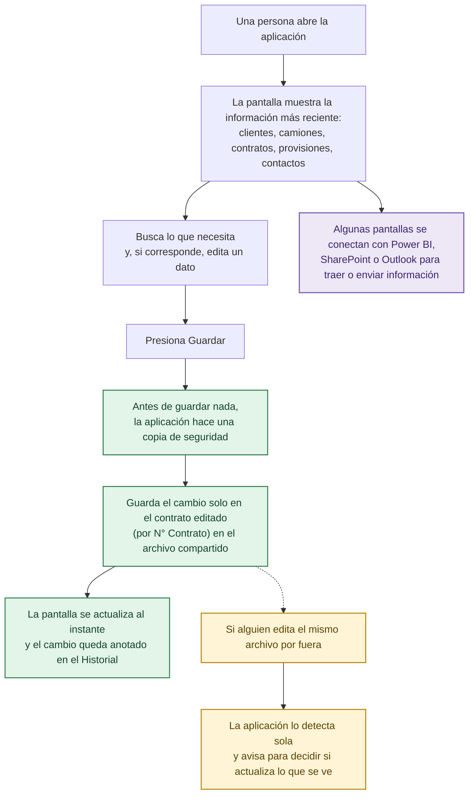

---

### A11 — ¿Cómo se relacionan las pantallas?

> Ver explicación detallada: [[14. Guía de General, Comercial y Operaciones]], [[15. Guía de Ingresos y Conciliación]]

Qué pantalla le entrega información a cuál. Comercial es el centro; Operaciones y Comercial se pasan los contratos de ida y vuelta.

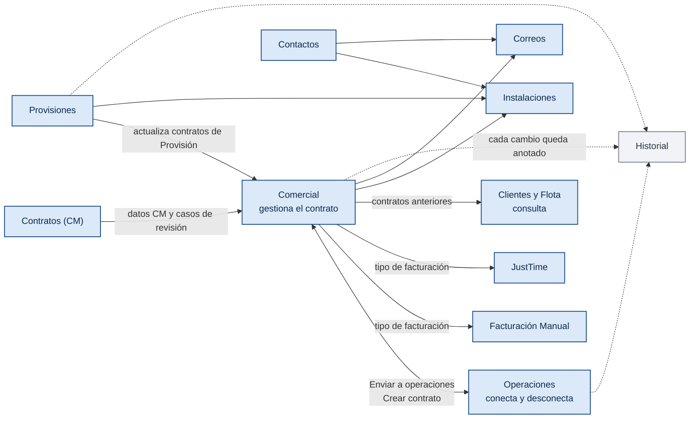

- Comercial es el centro de la flota; Provisiones y Contratos le entregan datos; Operaciones cierra el ciclo conectando o desconectando; Instalaciones junta información de varias pantallas una vez al mes; Contactos alimenta a quién se le escribe desde Correos; y todo cambio guardado queda anotado en Historial.

---

## Parte B — Procesos de negocio en detalle

Cómo viajan los datos entre las pantallas: provisiones, contratos de mantenimiento, facturación, correos y la sincronización con el RM.

### B1 — Provisiones → contrato

> Ver explicación detallada: [[05. Flujos de Datos y Sincronización]] §3.1, [[07. Procesos y Reglas de Negocio]] §2

Qué pasa con cada unidad cuando se guarda una provisión. Solo un contrato abierto de forma Provisión recibe cambios en Comercial.

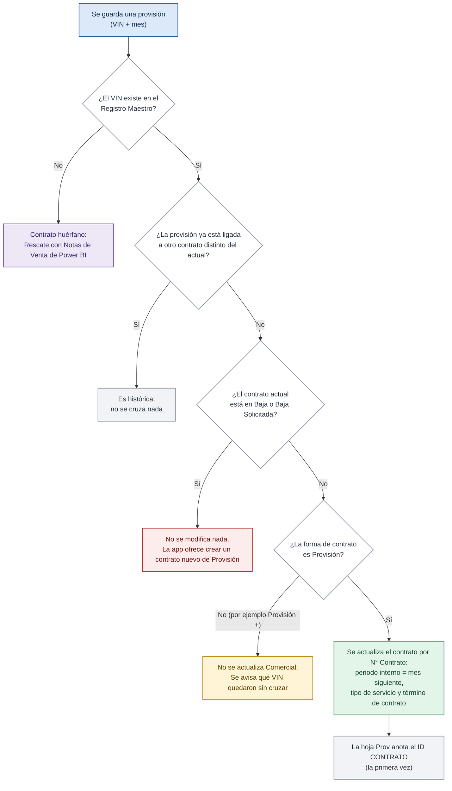

- El periodo interno que recibe Comercial es el **mes siguiente** al de la provisión: la provisión de septiembre de 2026 deja el contrato en «octubre - 2026».
- La lógica está en `provisiones_services.resolver_destino_provision`.

---

### B2 — Contratos de mantenimiento (CM) y Gestionar CM

> Ver explicación detallada: [[07. Procesos y Reglas de Negocio]] §4, [[05. Flujos de Datos y Sincronización]] §3.5

Desde que se importa el reporte mensual 3PC hasta que un caso queda listo para revisión. El equipo avisa; quien administra los CM decide.

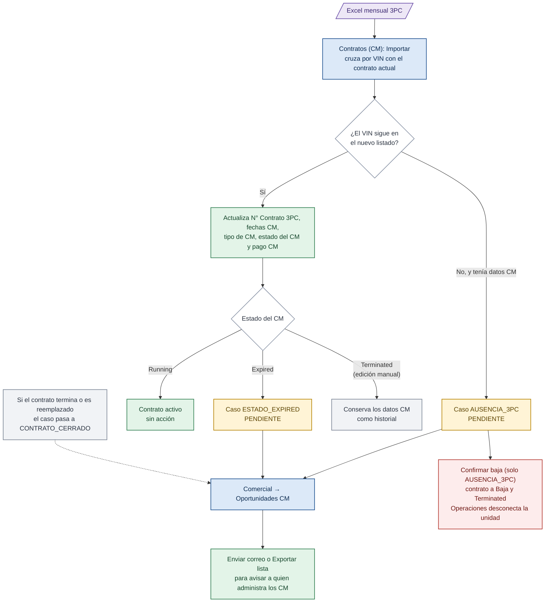

- Ausente del 3PC **nunca** se interpreta como baja ni como Expired: son dos carriles independientes.
- Los casos se guardan en `CasosBajaCM.csv` con el `ID CONTRATO`; las unidades con contrato terminado y desconectado ya no generan casos.
- **Confirmar baja** deja el CM en Terminated, pasa el contrato a Baja y lo envía a Operaciones › Bajas sin borrar los datos del CM; solo se habilita para AUSENCIA_3PC; para Expired solo se avisa.

---

### B3 — Ciclos de los casos de revisión CM

> Ver explicación detallada: [[07. Procesos y Reglas de Negocio]] §4

Cómo cambian de estado el contrato de mantenimiento y los casos que genera.

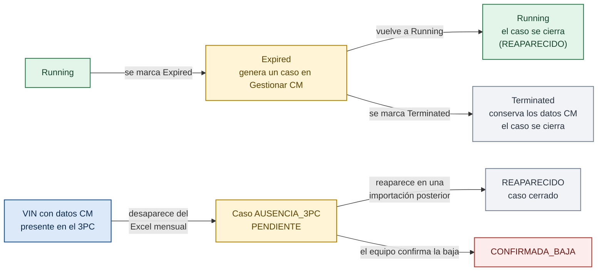

- Ambos ciclos son independientes aunque compartan el VIN.

---

### B4 — JustTime: estados de cada unidad

> Ver explicación detallada: [[07. Procesos y Reglas de Negocio]] §10, [[15. Guía de Ingresos y Conciliación]] §5

JustTime es el sistema donde se crea el contrato para facturar. La aplicación no se conecta: solo lleva el control de si cada unidad ya está creada.

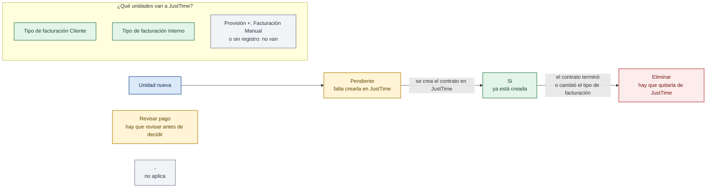

- Una **inconsistencia** es, por ejemplo, una unidad que va a JustTime y tiene «-», o un contrato terminado que sigue en Si o Pendiente. La pantalla solo la marca; nunca la corrige sola.
- Los cambios se hacen en el formulario de la unidad o en lote (Cambiar estado), siempre con confirmación.

---

### B5 — Facturación Manual

> Ver explicación detallada: [[07. Procesos y Reglas de Negocio]] §9, [[15. Guía de Ingresos y Conciliación]] §4

Cómo se arma la lista de clientes que se facturan a mano en cada período y qué se puede hacer con ella.

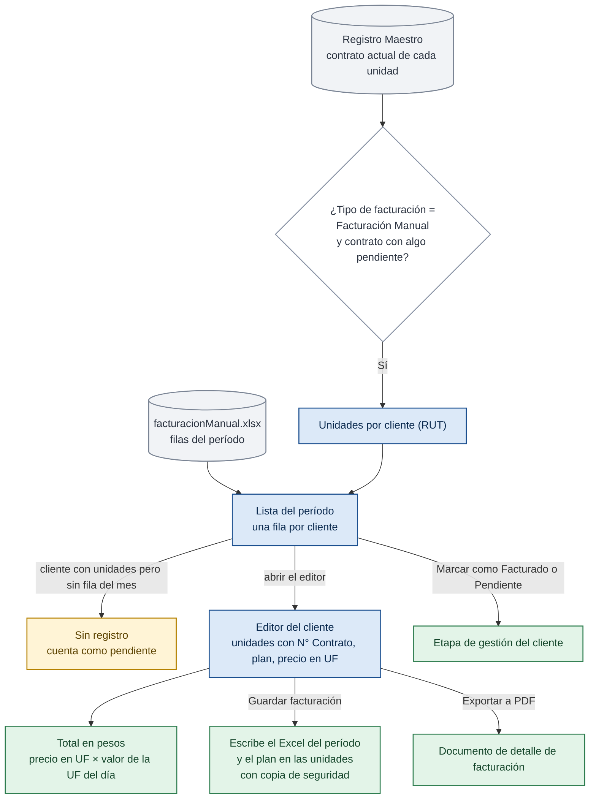

- Un contrato terminado y desconectado ya no se cuenta; si sigue conectado, se cuenta hasta que Operaciones lo desconecte.
- Pendiente de confirmar con el área de negocio: N° de orden de compra y HES.

---

### B6 — Envío de correos

> Ver explicación detallada: [[03_Vistas_y_Navegacion_UI]] §8, [[07. Procesos y Reglas de Negocio]] §8

Cómo se arma la lista de correos, cómo se envían y cómo se agrega un contacto que falta.

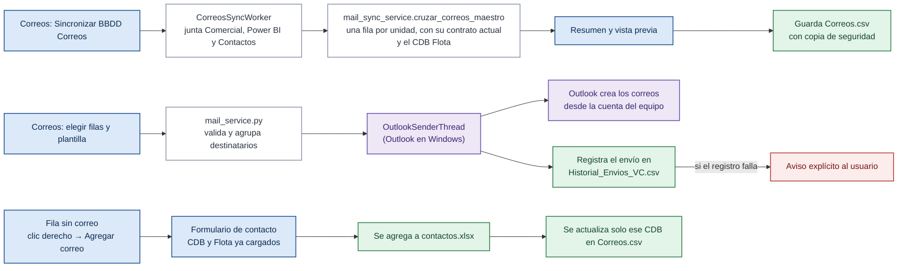

- Los borradores de «Contactar ejecutivo» (Operaciones) **no** se registran en el historial de envíos.

---

### B7 — Instalaciones: consolidado mensual

> Ver explicación detallada: [[05. Flujos de Datos y Sincronización]] §3.2, [[10. Manual de Operación]] §8

De dónde salen los datos del consolidado de instalaciones que se usa para facturar.

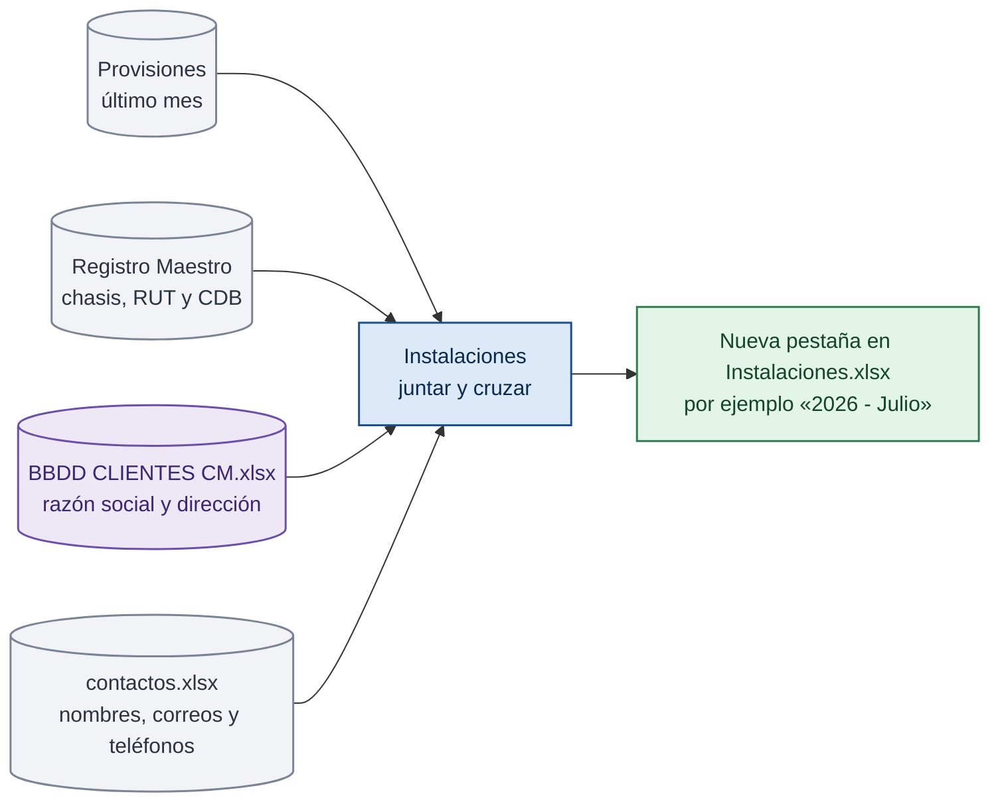

- Si alguna fuente falta, los campos correspondientes quedan vacíos en el consolidado.

---

### B8 — Sincronización con el RM de Javiera: hoy y destino

> Ver explicación detallada: [[05. Flujos de Datos y Sincronización]] §4.2, [[13. Matriz de Requerimientos y Trazabilidad]]

Hoy existe una sincronización con el Excel de Javiera que sirve solo para pruebas y desarrollo. El destino es que el Registro Maestro sea un solo archivo.

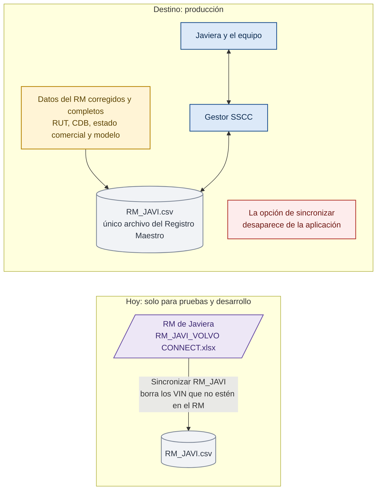

- Hoy los dos botones «Sincronizar RM_JAVI» (Comercial y Configuración) siguen visibles; ocultarlos va antes de la entrega.
- Antes del traspaso hay que corregir y completar los datos del `RM_JAVI_VOLVO CONNECT.xlsx` original.

---

### B9 — Sincronizaciones con SharePoint y Power BI

> Ver explicación detallada: [[05. Flujos de Datos y Sincronización]] §4

Las integraciones externas no usan una API: abren el navegador o leen la carpeta de Descargas.

```mermaid
flowchart TD
    subgraph SPS["Provisiones ← SharePoint"]
        SPS1["Abre el enlace de SharePoint en el navegador"]:::pantalla --> SPS2["Busca el archivo en Descargas (hasta 60 s)"]:::neutro
        SPS2 --> SPS3["Quita duplicados por AÑO-MES + VIN"]:::neutro --> SPS4["Agrega filas y fórmulas a provisionFelipe.xlsx"]:::accion
    end
    subgraph RES["Rescate de contratos huérfanos"]
        RES1["Reporte de Notas de Venta guardado<br/>o descarga nueva desde Power BI"]:::externo --> RES2{"¿El archivo ya se puede leer?"}:::neutro
        RES2 -->|"No (todavía protegido)"| RES3["Espera a que el usuario lo abra<br/>y lo vuelva a guardar en Excel"]:::aviso
        RES2 -->|Sí| RES4["Cruce por chasis<br/>(últimos 7 del VIN)"]:::neutro
        RES4 --> RES5["Registro completo o parcial"]:::accion
    end
    subgraph CON["Contactos"]
        CON1["contactos.xlsx"]:::archivo --> CON3["La pantalla queda lista<br/>cuando ambas fuentes terminan"]:::accion
        CON2["BBDD CLIENTES CM.xlsx (Power BI)"]:::externo --> CON3
    end
    classDef pantalla fill:#DCE9F8,stroke:#1B4F8F,color:#0B2A4F,stroke-width:1.5px
    classDef grupo fill:#1B4F8F,stroke:#0B2A4F,color:#FFFFFF,stroke-width:1.5px
    classDef accion fill:#E3F4E8,stroke:#2E7D4F,color:#14452A,stroke-width:1.5px
    classDef archivo fill:#F1F3F6,stroke:#7A8494,color:#2B3340,stroke-width:1.5px
    classDef externo fill:#EDE7F6,stroke:#6B4FA8,color:#3A2670,stroke-width:1.5px
    classDef alerta fill:#FDECEC,stroke:#B3372F,color:#6E1712,stroke-width:1.5px
    classDef aviso fill:#FFF4D6,stroke:#B58100,color:#5C4300,stroke-width:1.5px
    classDef neutro fill:#FFFFFF,stroke:#8A94A6,color:#2B3340,stroke-width:1.5px
```

---

## Parte C — Arquitectura técnica

Para quien mantiene la aplicación: capas, hilos, guardado, copias de seguridad, pruebas y componentes.

### C1 — Arquitectura general

> Ver explicación detallada: [[04. Arquitectura y Patrones del Sistema]] §1, [[01_Arranque_y_Configuracion]]

Las capas de la aplicación desde que el usuario la abre hasta los archivos de datos.

```mermaid
flowchart TD
    U["Usuario"]:::neutro --> M["main.py<br/>pantalla de carga y QApplication"]:::pantalla
    M --> MW["MainWindow<br/>menú lateral y área de trabajo"]:::pantalla
    MW --> UI["Pantallas: Clientes y Flota, Comercial, Operaciones,<br/>Ingresos y Conciliación, Administración, Configuración"]:::pantalla
    UI --> DM["DataManager<br/>datos en memoria (Singleton)"]:::accion
    UI --> EW["ExcelWriter<br/>guarda con copia de seguridad<br/>(rama CSV y rama Excel)"]:::accion
    DM --> ER["ExcelReader<br/>comparación de cambios externos"]:::accion
    EW --> XLS[("Archivos de datos<br/>RM_JAVI.csv y archivos Excel/CSV<br/>carpeta sincronizada con SharePoint")]:::archivo
    ER --> XLS
    DM -.carga asíncrona.-> XLS
    MW --> DASH["Dashboard<br/>(pantalla de espera)"]:::pantalla
    UI --> BROWSER["Navegador por defecto"]:::externo
    BROWSER --> SP["SharePoint y Power BI<br/>descargas manuales"]:::externo
    classDef pantalla fill:#DCE9F8,stroke:#1B4F8F,color:#0B2A4F,stroke-width:1.5px
    classDef grupo fill:#1B4F8F,stroke:#0B2A4F,color:#FFFFFF,stroke-width:1.5px
    classDef accion fill:#E3F4E8,stroke:#2E7D4F,color:#14452A,stroke-width:1.5px
    classDef archivo fill:#F1F3F6,stroke:#7A8494,color:#2B3340,stroke-width:1.5px
    classDef externo fill:#EDE7F6,stroke:#6B4FA8,color:#3A2670,stroke-width:1.5px
    classDef alerta fill:#FDECEC,stroke:#B3372F,color:#6E1712,stroke-width:1.5px
    classDef aviso fill:#FFF4D6,stroke:#B58100,color:#5C4300,stroke-width:1.5px
    classDef neutro fill:#FFFFFF,stroke:#8A94A6,color:#2B3340,stroke-width:1.5px
```

- No existe una capa de red o API intermedia: `DataManager`, `ExcelWriter` y `ExcelReader` acceden directamente al sistema de archivos.
- SharePoint y Power BI **no usan API**: son aperturas de URL en el navegador combinadas con la lectura de la carpeta de Descargas o con un visor embebido.

---

### C2 — DataManager

> Ver explicación detallada: [[02_Motor_de_Datos_Core]] §2, [[04. Arquitectura y Patrones del Sistema]] §5-6

Qué guarda en memoria el DataManager y cómo lo consumen las pantallas, incluida la vista de contratos actuales.

```mermaid
flowchart LR
    subgraph DM["DataManager (Singleton)"]
        direction TB
        DFM["df_master<br/>Registro Maestro: una fila por contrato"]:::archivo
        ACT["get_contratos_actuales_df()<br/>un contrato por VIN (el de mayor ID)"]:::accion
        DFP["df_prov (Provisiones)"]:::archivo
        DFC["df_contactos (Contactos)"]:::archivo
        DFL["df_logs / df_deleted (Auditoría)"]:::archivo
        FLAGS["is_loading_main / is_loading_prov /<br/>is_loading_contactos / is_app_saving"]:::neutro
        DFM --> ACT
    end
    L1["MainDataLoaderThread"]:::neutro -->|"lee CSV o Excel + DataFrameFormatter"| DFM
    L2["ProvisionesLoaderThread"]:::neutro -->|"lee Excel + calcula VAR"| DFP
    L3["ContactosLoaderThread"]:::neutro -->|"copia fantasma + reintentos"| DFC
    DM -->|"data_ready / provisiones_ready / contactos_ready"| UI["Pantallas"]:::pantalla
    UI -->|"get_comercial_df() / get_contratos_actuales_df() / ..."| DM
    UI -->|"inyección directa tras guardar"| DM
    classDef pantalla fill:#DCE9F8,stroke:#1B4F8F,color:#0B2A4F,stroke-width:1.5px
    classDef grupo fill:#1B4F8F,stroke:#0B2A4F,color:#FFFFFF,stroke-width:1.5px
    classDef accion fill:#E3F4E8,stroke:#2E7D4F,color:#14452A,stroke-width:1.5px
    classDef archivo fill:#F1F3F6,stroke:#7A8494,color:#2B3340,stroke-width:1.5px
    classDef externo fill:#EDE7F6,stroke:#6B4FA8,color:#3A2670,stroke-width:1.5px
    classDef alerta fill:#FDECEC,stroke:#B3372F,color:#6E1712,stroke-width:1.5px
    classDef aviso fill:#FFF4D6,stroke:#B58100,color:#5C4300,stroke-width:1.5px
    classDef neutro fill:#FFFFFF,stroke:#8A94A6,color:#2B3340,stroke-width:1.5px
```

- La flecha «inyección directa tras guardar» es informal a propósito: no existen setters formales en `DataManager`. Las pantallas reasignan atributos internos, lo que está documentado como violación de encapsulamiento.

---

### C3 — Flujo de guardado

> Ver explicación detallada: [[05. Flujos de Datos y Sincronización]] §2, [[06. Seguridad, Integridad y Resiliencia de Datos]] §1-2

Cómo se escribe una edición. El Registro Maestro (CSV) ubica la fila por N° Contrato; los demás archivos usan su propia llave (VIN o AÑO - MES).

```mermaid
sequenceDiagram
    participant U as Usuario
    participant UI as Pantalla (ej. Comercial)
    participant T as QThread (SaveExcelThread)
    participant EW as ExcelWriter
    participant FS as Disco
    participant DM as DataManager
    U->>UI: Edita celdas (pending_changes)
    U->>UI: Guardar
    UI->>UI: agregar_id_a_cambios (suma el N° Contrato)
    UI->>T: start(cambios)
    T->>EW: update_cells(...)
    EW->>DM: is_app_saving = True
    EW->>FS: _crear_backup() en data/backups
    alt la copia de seguridad falló
        EW-->>T: False (no toca el archivo real)
    else copia de seguridad correcta
        alt archivo CSV (Registro Maestro)
            EW->>FS: lee el CSV y ubica la fila por ID
            EW->>FS: escribe un temporal, fsync y copia sobre el destino
        else archivo Excel
            EW->>FS: clona a data/temp y escribe con openpyxl
            EW->>FS: fsync y reemplaza el archivo
        end
        EW->>FS: registra el cambio en LogApp.csv
        EW-->>T: True
    end
    T-->>UI: finished_signal
    UI->>DM: aplicar_cambios_pendientes (por ID) en memoria
    UI->>U: refresca la tabla
```

- Sin ID, el escritor caería en la primera fila del VIN (el contrato más antiguo). Por eso todos los guardados agregan el ID del contrato actual.

---

### C4 — Copias de seguridad y restauración

> Ver explicación detallada: [[06. Seguridad, Integridad y Resiliencia de Datos]] §2-3

La aplicación tiene tres mecanismos de copia de seguridad independientes, no uno solo.

```mermaid
flowchart TD
    subgraph A["1. Copia por escritura (ExcelWriter._crear_backup)"]
        A1["Antes de CADA update_cells, add_new_row,<br/>delete_row u overwrite_dataframe"]:::neutro
        A2["Copia UN archivo a data/backups/"]:::neutro
        A3["Conserva las últimas 10 por archivo"]:::neutro
    end
    subgraph B["2. Copia automática semanal (BackupManager)"]
        B1["Al iniciar la aplicación, solo los viernes"]:::neutro
        B2["Máximo 1 por semana ISO"]:::neutro
        B3["Copia TODOS los archivos maestros<br/>a data/backup_auto/"]:::neutro
        B4["Conserva los últimos 5"]:::neutro
    end
    subgraph C["3. Copia manual (Configuración)"]
        C1["Botón Realizar backup completo"]:::neutro
        C2["Copia TODOS los archivos maestros<br/>a data/backupManual/"]:::neutro
        C3["Sin retención automática"]:::neutro
    end
    R["Restaurar (Configuración → elegir copia)"]:::pantalla --> R1["Copia de seguridad del archivo actual"]:::accion
    R1 -->|"si falla, se cancela todo"| R2["Copia el backup sobre el Registro Maestro"]:::accion
    R2 --> R3["Reinicia la aplicación"]:::accion
    classDef pantalla fill:#DCE9F8,stroke:#1B4F8F,color:#0B2A4F,stroke-width:1.5px
    classDef grupo fill:#1B4F8F,stroke:#0B2A4F,color:#FFFFFF,stroke-width:1.5px
    classDef accion fill:#E3F4E8,stroke:#2E7D4F,color:#14452A,stroke-width:1.5px
    classDef archivo fill:#F1F3F6,stroke:#7A8494,color:#2B3340,stroke-width:1.5px
    classDef externo fill:#EDE7F6,stroke:#6B4FA8,color:#3A2670,stroke-width:1.5px
    classDef alerta fill:#FDECEC,stroke:#B3372F,color:#6E1712,stroke-width:1.5px
    classDef aviso fill:#FFF4D6,stroke:#B58100,color:#5C4300,stroke-width:1.5px
    classDef neutro fill:#FFFFFF,stroke:#8A94A6,color:#2B3340,stroke-width:1.5px
```

- Los tres mecanismos se complementan: el 1 protege cada transacción y el 2 y el 3 son fotos completas para desastres.
- Las copias nuevas del Registro Maestro empiezan con `RM_JAVI_backup_`; la restauración también acepta las antiguas `PruebasFM_backup_`.

---

### C5 — Cambios externos y Auto-Heal (Watchdog)

> Ver explicación detallada: [[04. Arquitectura y Patrones del Sistema]] §7, [[06. Seguridad, Integridad y Resiliencia de Datos]] §5 y §7

Qué pasa cuando alguien modifica el archivo fuera de la aplicación.

```mermaid
flowchart TD
    A["Se modifica el archivo fuera de la aplicación"]:::alerta --> B["FileWatcher (watchdog)"]:::neutro
    B --> C{"¿Fue un guardado propio (menos de 30 s)<br/>o is_app_saving activo (menos de 300 s)?"}:::neutro
    C -->|Sí| D["Se silencia el evento:<br/>fue la propia aplicación"]:::archivo
    C -->|No| E["MainWindow: CompareSnapshotThread"]:::neutro
    E --> F["Compara con data/cache/snapshot_comercial_hash.pkl<br/>y deja la lectura como precarga"]:::neutro
    F --> G{"¿Más de 200 cambios?"}:::neutro
    G -->|Sí| H["Auto-Heal: reconstruye el snapshot en silencio"]:::accion
    G -->|No| I["Avisa al usuario (campana)"]:::aviso
    I --> J{"¿El usuario acepta recargar?"}:::neutro
    J -->|Sí| K["DataManager.load_data_async()<br/>reutiliza la precarga si no cambió"]:::accion
    J -->|"No, o hay cambios sin guardar"| L["El usuario decide:<br/>guardar o descartar"]:::aviso
    classDef pantalla fill:#DCE9F8,stroke:#1B4F8F,color:#0B2A4F,stroke-width:1.5px
    classDef grupo fill:#1B4F8F,stroke:#0B2A4F,color:#FFFFFF,stroke-width:1.5px
    classDef accion fill:#E3F4E8,stroke:#2E7D4F,color:#14452A,stroke-width:1.5px
    classDef archivo fill:#F1F3F6,stroke:#7A8494,color:#2B3340,stroke-width:1.5px
    classDef externo fill:#EDE7F6,stroke:#6B4FA8,color:#3A2670,stroke-width:1.5px
    classDef alerta fill:#FDECEC,stroke:#B3372F,color:#6E1712,stroke-width:1.5px
    classDef aviso fill:#FFF4D6,stroke:#B58100,color:#5C4300,stroke-width:1.5px
    classDef neutro fill:#FFFFFF,stroke:#8A94A6,color:#2B3340,stroke-width:1.5px
```

---

### C6 — Bloqueo por archivo ocupado

> Ver explicación detallada: [[03_Vistas_y_Navegacion_UI]] §7.2, [[04. Arquitectura y Patrones del Sistema]] §12

Cómo la aplicación se bloquea cuando uno de sus archivos principales está abierto por otra persona o programa.

```mermaid
sequenceDiagram
    participant FLM as FileLockMonitorThread
    participant ALC as AppLockCoordinator
    participant MW as MainWindow
    participant U as Usuario
    loop cada 5 segundos
        FLM->>FLM: tick() sobre los archivos principales
        FLM-->>ALC: estado_cambiado(clave, ocupado)
    end
    ALC->>ALC: junta el estado de los archivos en un solo booleano
    alt al menos un archivo ocupado
        ALC-->>MW: estado_app_cambiado(True)
        MW->>MW: central_widget.setEnabled(False)
        MW->>U: banner rojo «Aplicación bloqueada»
    else todos disponibles
        ALC-->>MW: estado_app_cambiado(False)
        MW->>MW: central_widget.setEnabled(True)
        MW->>U: oculta el banner
    end
```

- El monitor solo informa ocupado o disponible por archivo: no identifica quién lo tiene abierto ni distingue un bloqueo de otra persona de uno transitorio de OneDrive.

---

### C7 — Carga de datos en General (GeneralDataPrepThread)

> Ver explicación detallada: [[03_Vistas_y_Navegacion_UI]] §7.1, [[12. Rendimiento y Optimizaciones de Interfaz]] §2

El procesamiento pesado de Clientes y Flota corre en un hilo aparte para que la pantalla no se congele.

```mermaid
sequenceDiagram
    participant UI as GeneralModule (hilo de la interfaz)
    participant W as GeneralDataPrepThread
    participant DM as DataManager
    UI->>DM: get_comercial_df() (copia independiente)
    alt ya hay un worker corriendo
        UI->>UI: marca _prep_pendiente = True (no lanza otro)
    else no hay worker
        UI->>W: start(copia)
        UI->>UI: _prep_en_curso = True
        W->>W: contratos_actuales + clientes y unidades
        W-->>UI: data_prepared_signal(resultado)
        UI->>UI: _prep_en_curso = False
        UI->>UI: guarda los DataFrames y actualiza filtros
        opt quedó _prep_pendiente
            UI->>DM: get_comercial_df() (copia NUEVA)
            UI->>W: start(copia nueva)
        end
    end
```

- El worker nunca toca widgets Qt, solo pandas. La protección usa una bandera propia (`_prep_en_curso`), no `QThread.isRunning()`.

---

### C8 — Componentes

> Ver explicación detallada: [[02_Motor_de_Datos_Core]], [[04. Arquitectura y Patrones del Sistema]] §3

Los módulos del código y cómo se llaman entre sí, incluidos los servicios por pantalla.

```mermaid
flowchart TB
    subgraph UI["src/ui/"]
        MW2["MainWindow"]:::pantalla
        MODS["Pantallas<br/>Comercial, Operaciones, General, Provisiones,<br/>Contratos, JustTime, Facturación Manual, ..."]:::pantalla
        CT["custom_table.py<br/>VolvoTableWidget / PandasTableModel"]:::pantalla
        FU["formulario_unidad.py<br/>GuardadoUnidadesMixin"]:::pantalla
    end
    subgraph CORE["src/core/"]
        DM2["DataManager"]:::accion
        EWc["ExcelWriter<br/>+ backend CSV (por ID)"]:::accion
        ERc["ExcelReader"]:::accion
        FWc["FileWatcher"]:::accion
        DFF["DataFrameFormatter"]:::accion
        BM["BackupManager"]:::accion
    end
    subgraph SVC["src/services/"]
        CSV["comercial_services<br/>contratos_actuales, agregar_id_a_cambios,<br/>puede_crear_contrato"]:::neutro
        OSV["operaciones_services"]:::neutro
        PSV["provisiones_services<br/>resolver_destino_provision"]:::neutro
        CMS["cm_bajas_service"]:::neutro
        JSV["justtime_service"]:::neutro
        FSV["facturacion_manual_service"]:::neutro
        MAIL["mail_service, mail_sync_service,<br/>mail_templates, mail_registro,<br/>contacto_correo_service"]:::neutro
    end
    subgraph EXT["Externo"]
        XLSX[("Archivos CSV y Excel")]:::archivo
        OUTLOOK["Outlook (COM)"]:::externo
        WEB["Navegador, Power BI, SharePoint"]:::externo
    end
    MW2 --> MODS
    MODS --> CT
    MODS --> FU
    MODS --> DM2
    FU --> EWc
    MODS --> EWc
    DM2 --> DFF
    ERc --> DFF
    DM2 -.-> ERc
    EWc --> XLSX
    ERc --> XLSX
    FWc --> XLSX
    FWc --> MW2
    BM --> XLSX
    MODS --> CSV
    MODS --> OSV
    MODS --> PSV
    MODS --> CMS
    MODS --> JSV
    MODS --> FSV
    MODS --> MAIL
    MAIL --> EWc
    MODS --> OUTLOOK
    MODS --> WEB
    classDef pantalla fill:#DCE9F8,stroke:#1B4F8F,color:#0B2A4F,stroke-width:1.5px
    classDef grupo fill:#1B4F8F,stroke:#0B2A4F,color:#FFFFFF,stroke-width:1.5px
    classDef accion fill:#E3F4E8,stroke:#2E7D4F,color:#14452A,stroke-width:1.5px
    classDef archivo fill:#F1F3F6,stroke:#7A8494,color:#2B3340,stroke-width:1.5px
    classDef externo fill:#EDE7F6,stroke:#6B4FA8,color:#3A2670,stroke-width:1.5px
    classDef alerta fill:#FDECEC,stroke:#B3372F,color:#6E1712,stroke-width:1.5px
    classDef aviso fill:#FFF4D6,stroke:#B58100,color:#5C4300,stroke-width:1.5px
    classDef neutro fill:#FFFFFF,stroke:#8A94A6,color:#2B3340,stroke-width:1.5px
```

---

### C9 — Clases del núcleo de datos

> Ver explicación detallada: [[02_Motor_de_Datos_Core]]

Las clases principales del núcleo y cómo se relacionan.

```mermaid
classDiagram
    class DataManager {
        +df_master
        +df_prov
        +df_contactos
        +df_logs
        +df_deleted
        +is_app_saving
        +save_timestamp
        +get_comercial_df()
        +get_contratos_actuales_df()
        +load_data_async()
    }
    class ExcelWriter {
        +update_cells()
        +add_new_row()
        +delete_row()
        +overwrite_dataframe()
        -_crear_backup()
        -_log_changes()
        -_log_deleted()
    }
    class ExcelReader {
        +compare_snapshot()
        +compare_snapshot_desde_df()
        +get_commercial_data()
    }
    class DataFrameFormatter {
        +clean()
        -_validate_columns()
    }
    class FileWatcher {
        +file_changed_signal
    }
    class BackupManager {
        +crear_backup_manual()
        +crear_backup_automatico_si_corresponde()
    }
    DataManager --> DataFrameFormatter : usa para limpiar cargas
    ExcelReader --> DataFrameFormatter : usa para snapshots
    ExcelWriter --> DataManager : marca is_app_saving
    FileWatcher --> DataManager : consulta is_app_saving
    BackupManager ..> ExcelWriter : mecanismo independiente y complementario
```

---

### C10 — Secuencia de arranque

> Ver explicación detallada: [[01_Arranque_y_Configuracion]] §3

Qué ocurre desde que se abre la aplicación hasta que aparece la ventana principal.

```mermaid
sequenceDiagram
    participant OS as Windows
    participant M as main.py
    participant S as CustomSplashScreen
    participant P as PrecargaDatosThread
    participant MW as MainWindow
    participant DM as DataManager
    M->>OS: QT_QPA_PLATFORM=windows:darkmode=0
    M->>M: QApplication + estilo Fusion + styles.qss + GestorTema
    M->>S: instancia y muestra la pantalla de carga
    M->>M: app.exec()
    S->>P: start()
    P-->>S: importado (pandas listo)
    S->>S: anima isotipo, VOLVO, barra y camión
    P->>P: leer_datos_principales()
    P-->>S: finished
    S->>DM: guardar_precarga_principal()
    S->>S: espera el fin de la animación (barra al 100 %)
    S->>MW: MainWindow() + show()
    MW->>DM: load_data_async() usa la precarga
    DM-->>MW: data_ready
    S->>S: fundido y close()
```

---

### C11 — Cómo se verifican los cambios

> Ver explicación detallada: [[11. Pruebas y Auditoría de Tests]]

El camino de una modificación desde el código hasta los documentos de calidad. Los datos de prueba son falsos y no tocan los archivos reales.

```mermaid
flowchart LR
    DEV["Cambio en el código"]:::neutro --> T["Suite de pruebas<br/>src/tests"]:::pantalla
    T --> SB["Entorno de prueba (sandbox)<br/>datos falsos en src/tests/mock_data"]:::archivo
    T --> AUD["Auditor<br/>src/tests/auditor/run_auditor.py"]:::accion
    AUD --> LOGS["Logs en src/tests/logs"]:::archivo
    AUD --> QS["quality_sync.py<br/>y presentacion_calidad.py"]:::accion
    QS --> X1["Reporte de Ejecución de Pruebas.xlsx<br/>con hoja Resumen"]:::archivo
    QS --> X2["Casos de Prueba.xlsx"]:::archivo
    QS --> X3["Plan de Pruebas.docx"]:::archivo
    QS --> X4["Plan de Gestión de Cambios.docx"]:::archivo
    MAN["Documentos manuales<br/>Reporte de Defectos.docx<br/>Solicitud de Cambio (RFC).docx"]:::aviso
    X1 -.-> MAN
    classDef pantalla fill:#DCE9F8,stroke:#1B4F8F,color:#0B2A4F,stroke-width:1.5px
    classDef grupo fill:#1B4F8F,stroke:#0B2A4F,color:#FFFFFF,stroke-width:1.5px
    classDef accion fill:#E3F4E8,stroke:#2E7D4F,color:#14452A,stroke-width:1.5px
    classDef archivo fill:#F1F3F6,stroke:#7A8494,color:#2B3340,stroke-width:1.5px
    classDef externo fill:#EDE7F6,stroke:#6B4FA8,color:#3A2670,stroke-width:1.5px
    classDef alerta fill:#FDECEC,stroke:#B3372F,color:#6E1712,stroke-width:1.5px
    classDef aviso fill:#FFF4D6,stroke:#B58100,color:#5C4300,stroke-width:1.5px
    classDef neutro fill:#FFFFFF,stroke:#8A94A6,color:#2B3340,stroke-width:1.5px
```

- Los archivos de la carpeta `duoc/calidad` se actualizan al ejecutar el auditor.
- El auditor se cae a veces de forma nativa; se recomienda ejecutarlo con `python -X faulthandler src/tests/auditor/run_auditor.py` y verificar `app_config.json` después (BUG-011).

---

## Parte D — Diagramas de arquitectura y modelo de datos

Los cinco diagramas originales hechos en draw.io, unidos aquí para verlos en un solo lugar. Se pueden ampliar y moverse con la barra de cada diagrama; los archivos .drawio siguen en la carpeta diagramas.

### D1 — Arquitectura general explicada en simple

> Ver explicación detallada: [[04. Arquitectura y Patrones del Sistema]] §1

Quién usa la aplicación, cómo está organizada (las pantallas del menú lateral) y dónde guarda la información.

> Archivo: `diagramas/arquitectura_general.drawio` (se edita con draw.io; en `diagramas/index.html` se ve dibujado y se puede ampliar).

- Actualizado el 14-10-2026: la aplicación se llama Gestor SSCC y el Registro Maestro es `RM_JAVI.csv`.

---

### D2 — Comunicación entre el sistema de gestión y Azure

> Ver explicación detallada: [[05. Flujos de Datos y Sincronización]]

Cómo conviven el sistema de gestión y la plataforma Azure: un solo lugar para los datos (SharePoint), cada archivo con un único dueño y cero trabajo duplicado.

> Archivo: `diagramas/comunicacion_gestion_azure.drawio` (se edita con draw.io; en `diagramas/index.html` se ve dibujado y se puede ampliar).

---

### D3 — Modelo de datos 1: cómo llegaron los datos

> Ver explicación detallada: [[02_Motor_de_Datos_Core]], [[13. Matriz de Requerimientos y Trazabilidad]]

Cada archivo tal como lo entrega su dueño: columnas originales, sin llaves comunes ni formatos estandarizados.

> Archivo: `diagramas/modelo_datos_1_origen.drawio` (se edita con draw.io; en `diagramas/index.html` se ve dibujado y se puede ampliar).

- Actualizado el 14-10-2026 con el nombre `RM_JAVI.csv` (el Registro Maestro).

---

### D4 — Modelo de datos 2: cómo se usan y se conectan en la aplicación

> Ver explicación detallada: [[02_Motor_de_Datos_Core]], [[07. Procesos y Reglas de Negocio]] §1.aa

El Registro Maestro es la base central: cada fuente se une a él por VIN o por CDB, y la aplicación normaliza nombres y valores al cargar.

> Archivo: `diagramas/modelo_datos_2_integracion.drawio` (se edita con draw.io; en `diagramas/index.html` se ve dibujado y se puede ampliar).

- Actualizado el 14-10-2026 con el nombre `RM_JAVI.csv`, la columna `ID` de contrato, `CDB COMERCIAL` y `CDB FLOTA`, y los archivos de ejecutivos y de envíos. No muestra la pestaña de contratos anteriores (Fase 2); ver el diagrama A2 de esta página.

---

### D5 — Página web: estado del alcance

Qué funcionalidades de la página web ya están implementadas y cuáles faltan.

> Archivo: `diagramas/pagina_web_alcance.drawio` (se edita con draw.io; en `diagramas/index.html` se ve dibujado y se puede ampliar).

---

## Documentos relacionados

- [[00_Indice_Principal]] — punto de entrada del Vault
- [[01_Arranque_y_Configuracion]] — detalle técnico del arranque (C10 aquí)
- [[02_Motor_de_Datos_Core]] — detalle técnico del DataManager (C2 aquí)
- [[03_Vistas_y_Navegacion_UI]] — módulos de UI representados en los diagramas de componentes
- [[04. Arquitectura y Patrones del Sistema]] — arquitectura general y patrones (C1 y C8 aquí)
- [[05. Flujos de Datos y Sincronización]] — flujos técnicos completos (partes B y C)
- [[06. Seguridad, Integridad y Resiliencia de Datos]] — copias de seguridad, watchdog y auto-heal (C4 y C5)
- [[07. Procesos y Reglas de Negocio]] — reglas de negocio detrás de los cruces (partes A y B)
- [[09. Despliegue y Onboarding]] — cómo instalar y ejecutar lo que aquí se diagrama
- [[10. Manual de Operación]] — cómo un usuario de negocio vive estos flujos
- [[11. Pruebas y Auditoría de Tests]] — el flujo de calidad (C11)
- [[12. Rendimiento y Optimizaciones de Interfaz]] — detalle del diagrama C7
- [[14. Guía de General, Comercial y Operaciones]] y [[15. Guía de Ingresos y Conciliación]] — las pantallas en lenguaje de negocio (parte A)
